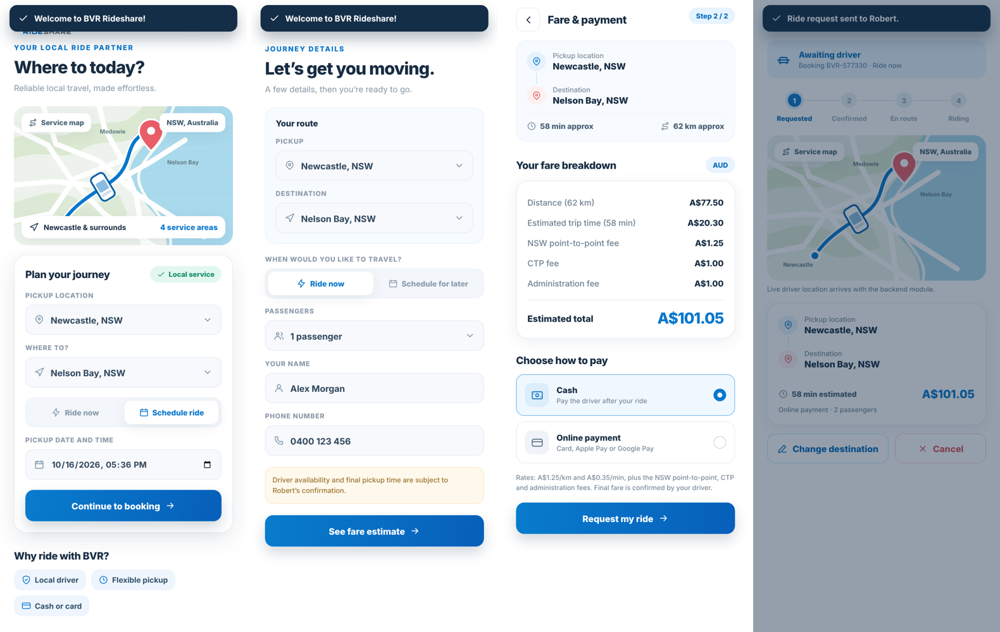
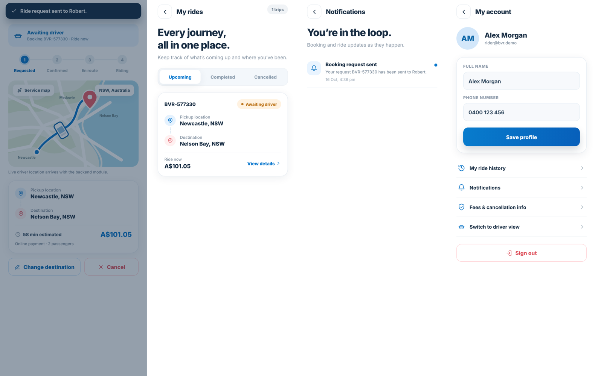
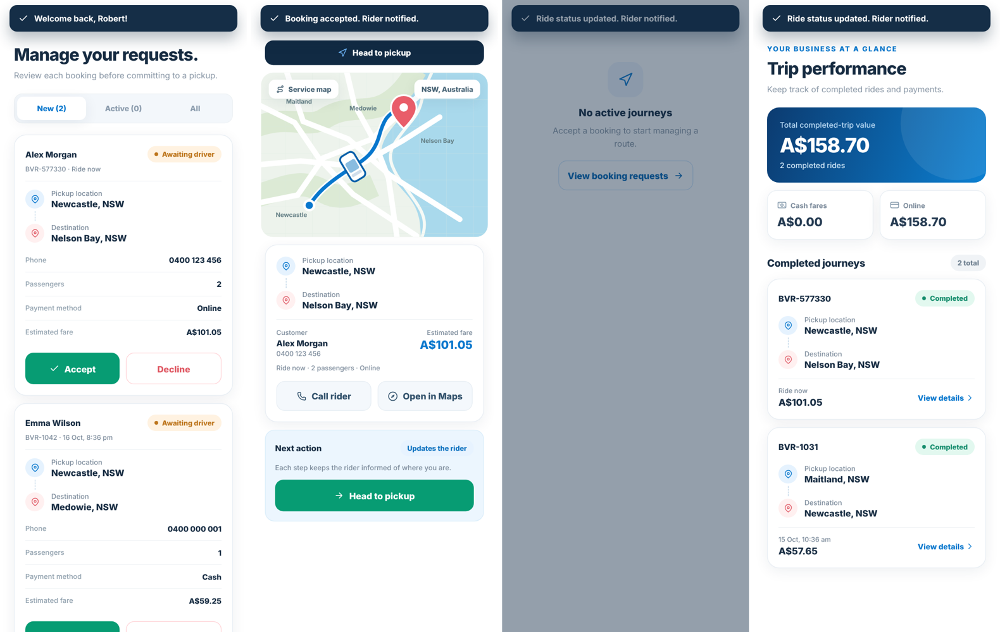

# BVR Rideshare

Cross-platform (iOS, Android, web) ride booking app for BVR Rideshare, Robert Burns' single-driver service covering Newcastle, Medowie, Maitland and Nelson Bay (NSW). Built with Expo SDK 57, Expo Router and TypeScript.

## Delivery plan

| Module | Scope | Status |
| --- | --- | --- |
| 1. UI | Every screen for riders and the driver, running on on-device mock data | **This repo, now** |
| 2. Backend | Supabase auth and database, Stripe card payments plus cash, push notifications, live trip status | Next |
| 3. Testing and release | Logic and end-to-end tests, device testing, TestFlight and Play internal builds | After module 2 |

## Run it

```bash
npm install
npx expo start        # scan the QR code with Expo Go (store version, SDK 57)
npx expo start --web  # or open in a browser
```

Demo logins (also offered on the sign-in screen):

| Role | Email | Password |
| --- | --- | --- |
| Rider | rider@bvr.demo | BVRdemo123 |
| Driver (Robert) | robert@bvr.demo | BVRdemo123 |

One device can be signed in as both. Use **Switch to driver view** (rider Account tab) or **Switch to rider view** (driver Settings) to watch a booking move between the two sides.

## What's in module 1

**Rider:** splash, sign in, sign up, home with route planner (ride now or scheduled), booking details (passengers, name, phone), fare breakdown with payment choice, live ride status with stepper, change destination, cancel (with cancellation fee once confirmed), ride history with receipts and star ratings, notifications, account.

**Driver:** dashboard with availability toggle and metrics, booking requests (accept, decline, 90-minute clash check), trip navigation with step-by-step status updates, call rider, open in Maps, earnings (cash vs online), fare and cancellation-fee settings.

**Fare:** `distance × km rate + time × minute rate + NSW point-to-point $1.25 + CTP $1.00 + admin $1.00`, see `src/lib/fare.ts`. The km and minute rates are placeholders ($1.25/km, $0.35/min) that the driver can change in Settings until the client confirms them.

## Project layout

```
src/
  app/            Expo Router routes
    (auth)/       sign-in, sign-up
    (rider)/      rider tabs (home, trips, notifications, profile) + book, fare, ride/[id]
    driver/       driver tabs (index, requests, navigate, earnings) + settings, notifications
  components/     shared UI (buttons, fields, sheets, map, booking cards, tab bar)
  screens/        screens shared between routes
  state/          AppStore: all data and actions (mock for module 1)
  lib/            fare engine and formatting (pure, unit tested)
  data/           types and seed data
  theme/          colours (from the logo), type, spacing, shadows
```

Screens only read and write through `src/state/AppStore.tsx`. In module 2 each store action becomes a Supabase call, so the screens don't need to change.

## Checks

```bash
npm run typecheck
npm test
```

## Placeholders to replace in module 2

- Mock sign-in and accounts → Supabase Auth
- Route distances between the four towns → routing API with real addresses
- Simulated driver position on the map (`src/lib/geo.ts`) → driver's live GPS; curved route line → routing provider polyline
- Android release builds need a Google Maps API key (`react-native-maps` plugin in app.json); Expo Go works without one
- Online payment option → Stripe (cards, Apple Pay, Google Pay)
- In-app notifications → push notifications

## Screenshots




